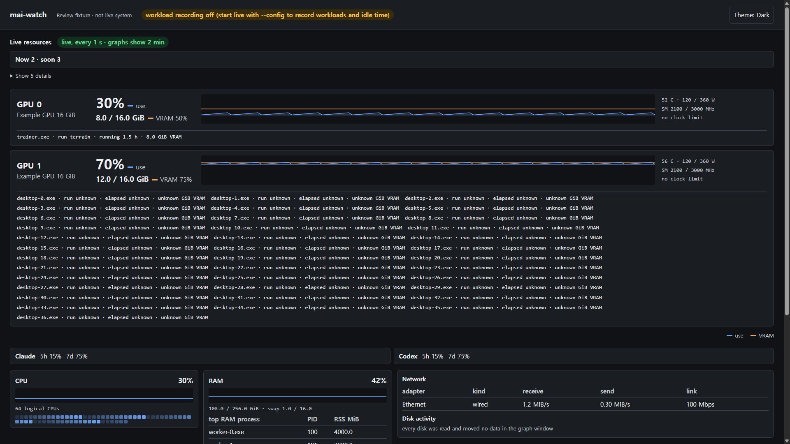
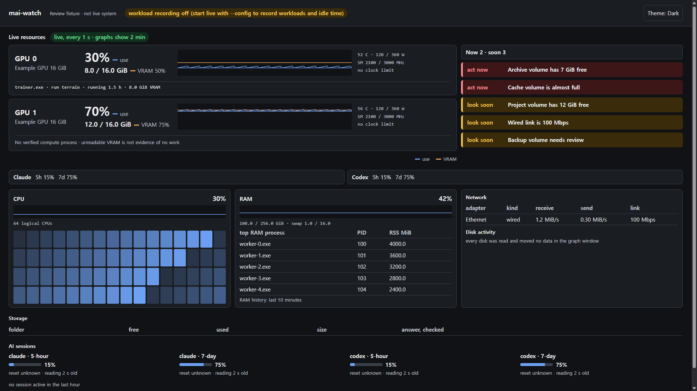
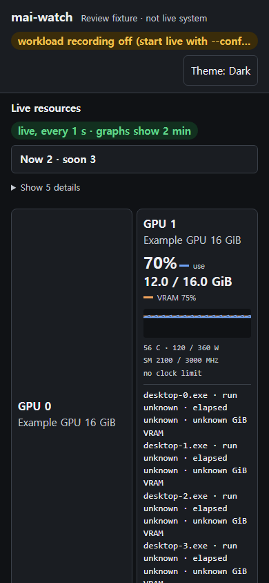
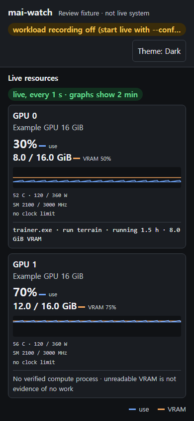

Category: verification
Author: pipeline, 2026-10-23
Evidence: mai-os#55, baseline 01dcc11, renderer and browser measurements below
Summary: warning placement, aligned host cards, verified GPU processes and stacked mobile GPUs
Status: Windows checks passed; merge and installed-dashboard restart not performed

# mai-watch layout follow-up

## Scope and result

The owner approved this implementation while temporarily delegating the super role to pipeline. Changes remain in a separate worktree and branch. No existing dashboard, GPU workload or other session was restarted or stopped.

| Request | Result and evidence |
|---|---|
| Use the empty warning area | Warnings sit beside GPUs on desktop; all five fixture warnings start expanded |
| Align card edges | At 1920 CSS pixels the CPU, RAM and network cards are each 611 by 327 pixels, with identical top and bottom edges; warning and network left edges are both 1270 pixels |
| Measured compute processes only | Unknown, zero or negative VRAM and placeholder names are excluded; the sampler validates PIDs before metadata access; at most three entries per GPU, ordered by VRAM |
| Fill the CPU card | 64 core cells occupy a 16-column grid on desktop; measured cell height 47.625 pixels, versus the previous 9 pixels |
| Stack mobile GPUs | At 390 CSS pixels both GPU cards have the same left edge and the second starts below the first |
| Keep important information open | GPUs, warning details, quota highlights and host metrics are outside closed mobile groups; long storage and session tables can still be folded |

An unavailable compute query remains `Process list unknown`. A filtered empty list says `No verified compute process`, with a warning that unreadable VRAM does not prove no work is running. In particular, WDDM can hide memory for a real workload. This is not a training classifier. Job and idle judgments are unchanged. The renderer repeats the filter so a new viewer cannot show an old sampler's unverified desktop entries.

## Paired screenshots

These four public images use the same synthetic fixture: two GPUs, 64 CPU cores, five warnings, two quota summaries and 37 desktop entries with unknown VRAM. The banner identifies the input as a review fixture, not a live system. The baseline is rendered directly from Git without changing the checkout. Each viewport is set with CDP device metrics, not merely the size of the PNG.

The running dashboard was also captured locally at both exact viewport sizes. Those captures are not published because they can contain local process and session details. The fixture comparison below is the reproducible, public-safe evidence. After images are not evidence of an installed production upgrade.

### Desktop, 1920 by 1080 CSS pixels

Before:



After:



### Mobile, 390 by 844 CSS pixels

These are viewport screenshots. Content below the viewport still requires scrolling, but no disclosure tap is needed for warnings or quota highlights.

Before:



After:



## Verification

- `python common/run_all_tests.py`: exit 0, 501 tests run, zero failed files. Five optional Node integration tests skipped because `MAI_CODEX_TEST_EXE` and `MAI_NPM_TEST_CLI` were not configured. mai-watch alone contributes 173 tests. The dashboard tests were not skipped.
- Added backend and real-renderer tests failed before the fix and passed after it. Cases cover unavailable VRAM, permission placeholders, zero and negative values, per-GPU caps, query failure and visibility outside closed mobile groups.
- The former test that asserted the literal horizontal two-GPU CSS was removed. Actual browser geometry now checks the replacement vertical requirement instead of blessing a CSS string.
- The first full-suite attempt exposed that obsolete test and failed. The final full run above was made after removing it. No failing file was skipped.
- Browser check against baseline: exit 1, detecting hidden warnings, desktop process leakage, host/core geometry problems and mobile horizontal GPUs.
- Browser check against changed files: exit 0 at both widths. No horizontal overflow, five expanded warning rows, one measured fixture compute process. Shared overview/host grid edges were checked separately: the check first detected a 4-pixel discrepancy, then passed after the grids were unified.
- Measurements: [baseline JSON](before-layout.json), [new JSON](after-layout.json).
- `git diff --check`: exit 0.

Reproduce from the repository root with a local Chrome/Chromium path:

```sh
python tools/mai-watch/tests/check_layout_browser.py --browser /path/to/chrome --out /tmp/watch-review
python tools/mai-watch/tests/check_layout_browser.py --browser /path/to/chrome --out /tmp/watch-review --ref 01dcc11 --label before
```

The second command intentionally returns 1 because the baseline violates the new requirements. Node.js 22 or later is required for the built-in WebSocket client. The runner serves a fixed synthetic fixture on loopback and closes only the browser it starts. It does not install packages or modify dashboard configuration.

## Limits and handover

Local measurements used Windows, Python 3.13.9, Node.js 24.13.0 and Chrome. Linux, macOS and a real phone were not measured in this review. Browser results apply to the known fixture, not every possible GPU, core count or NIC name. Cross-platform CI must be read separately before maintainer merge.

Deployment remains a maintainer decision. A copied pip installation needs an update and restart before sampler changes take effect. This task deliberately does neither. No quota, notification, alert threshold, endpoint or authentication behavior was changed.
