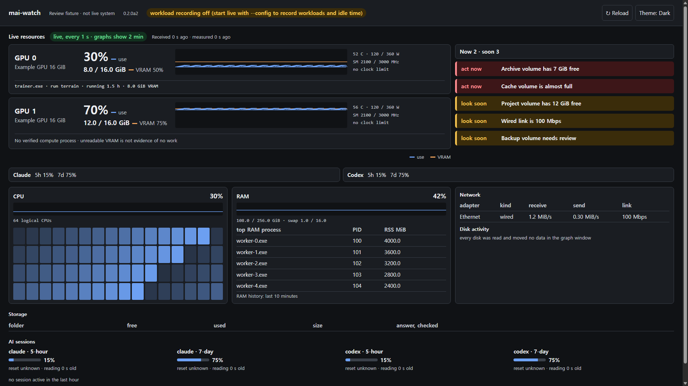
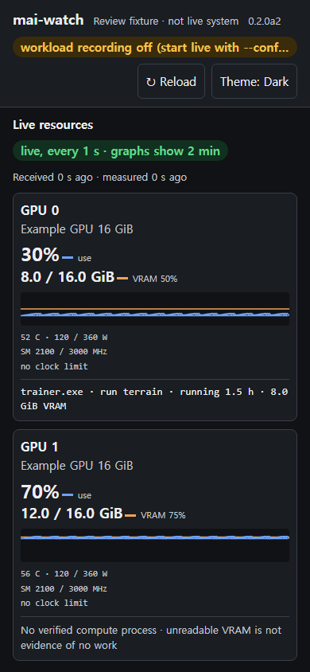

Category: release verification
Author: pipeline, 2026-10-23
Evidence: owner approval in mai-os#55, real viewer tests and packaged artifact
Summary: mai-watch 0.2.0a2, mobile reload, bounded reconnection and separate data ages
Status: local checks passed; deployment receipt belongs in mai-os#55

# 0.2.0a2 recovery and freshness

## Delivered scope

- A labelled reload button beside the theme control, both at least 44 CSS pixels high. It reloads the page, not the monitor, and suppresses repeated activation.
- Immediate reconnection on visibility/pageshow/online, coalesced for 250 ms. Each source has one loop and no overlapping regular request. A replaced request cannot render late data.
- A six-second deadline covering headers and body consumption, abort on timeout, and retry after three seconds. Both live and workload reads use it.
- Received age and measurement age are separate. A one-second UI timer ages them even while a request is pending. A successful response with old measurements remains stale.
- The theme is retained across reload. Page-local disclosure and scroll state may reset. Server-side graph history is not cleared by reload.
- Version metadata, package version and page label are aligned at 0.2.0a2. No new dependency, account, outbound telemetry or remote-control endpoint.

## Evidence

`python common/run_all_tests.py`: exit 0, 512 tests, zero failed files. Five existing optional Codex/npm integration tests skipped because their explicit executable settings were absent. The new viewer suite runs ten tests with no skips and is part of the common command and all three OS CI jobs.

The first eight tests failed before the connection helper existed. Known-answer cases cover a hung response body, HTTP error/retry, no overlap, late response suppression, coalesced resume events, stale measurement versus fresh receipt, independent age calculation and duplicate reload. Additional cases cover stop and malformed JSON.

Eight isolated mechanical mutations were also tested. Removing the deadline, overlap guard, generation check, measurement-age check, reload repeat guard, hidden-page guard, resume coalescing or actual reload made at least one assertion fail in every case. Production source was not altered for these checks. The final browser runs at both widths passed.

Actual Chrome CDP checks run at exact 1920x1080 and 390x844 CSS viewports. In-page network fault injection verifies that ages keep changing without a response, timeout becomes disconnected, resume recovers in one replacement request, fresh HTTP cannot hide stale samples, a temporary 404 does not permanently hide an established live view, workload HTTP failures retry, and the reload button navigates while preserving the selected theme. The final layout also checks aligned host cards, open warnings/limits, vertical mobile GPUs and no horizontal overflow. See [measurements](after-layout.json).





Images are explicitly labelled synthetic review fixtures, not a live workload. Real production screenshots are kept locally rather than publishing session and process details.

During verification the browser probe initially failed because its new-document fault injection was not attached. Enabling the CDP Page domain and asserting injection before using it exposed a second fixture error: forced dark localStorage on every load overrode the saved theme. The fixture now relies on emulated OS theme, leaving app preferences alone. These failures were not waved through as product success. Both full browser runs passed after the test-harness corrections.

An added temporary-404 probe then caught a real inherited behavior: any 404 stopped live polling permanently. The established-view case now stays visible as disconnected and retries; only an initial 404 identifies plain serve mode. That probe failed before the guard changed. Final results are the measurements linked above, not the earlier partial runs.

The wheel was built with `pip wheel --no-deps --no-build-isolation`. The new viewer-connection.js appears in its package contents. No generated build directory is staged. Public package-index publishing is not part of this release.

Reproduce:

```sh
python common/run_all_tests.py
python tools/mai-watch/tests/check_layout_browser.py --browser /path/to/chrome --out /tmp/watch-recovery --recovery
```

Browser automation uses a temporary loopback fixture and its own Chrome profile. It never disconnects the real machine, restarts the installed monitor, or creates GPU load. Real-phone behavior and non-Windows browser rendering remain unmeasured locally, even when cross-platform unit CI passes.

## Approved direction, later release gates

The owner approved the priority direction, not an untested claim about market demand. These items remain separate follow-ups, in this order:

| Priority | Next scope | Gate before calling it done |
|---|---|---|
| P0 | First-run capability diagnosis and clear unknown reasons | Known missing GPU/tool/permission inputs produce specific explanations, never fake zero |
| P0 | Safe sharing and privacy-safe support bundle | Keep loopback/private-network default; verify redaction and exposure boundaries; internet access needs its own authentication design |
| P1 | Warning evidence, duration and suggested checks | Do not claim a cause the measurements cannot establish; test persistence and false alerts |
| P1 | Interest-based layout | Test that hidden information cannot hide important warnings; validate with actual users |
| P2 | Time-window selection and incident history | Define retention, disk budget and gaps before adding storage |

User validation should check whether a new user can recognize stale data, understand unknown, and choose a next action without a maintainer explaining the screen. No interviews or real-phone studies have been performed for this release. More charts, autonomous diagnosis, destructive remote actions, multi-tenancy and billing are deliberately not added.
